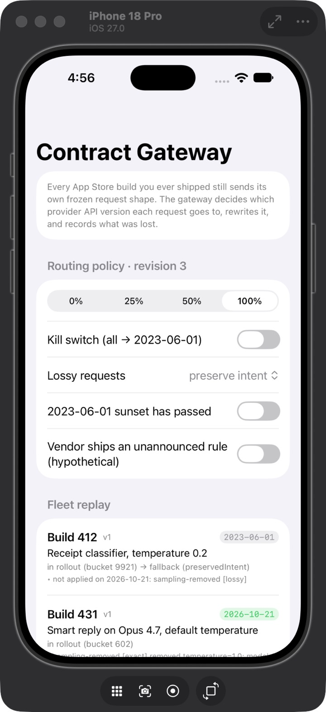
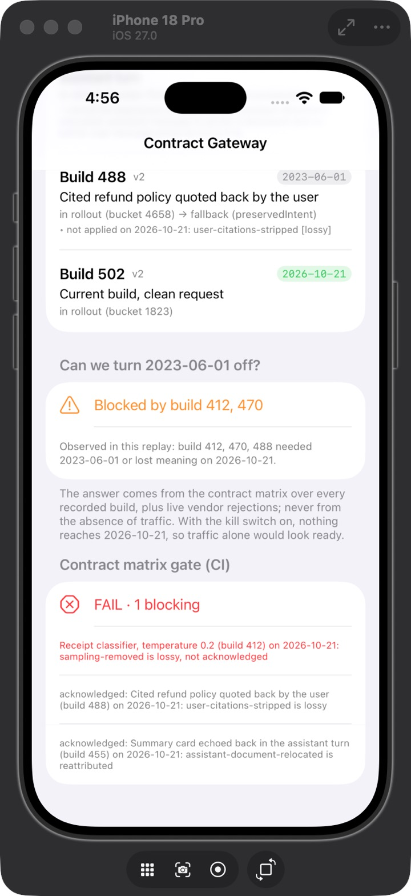
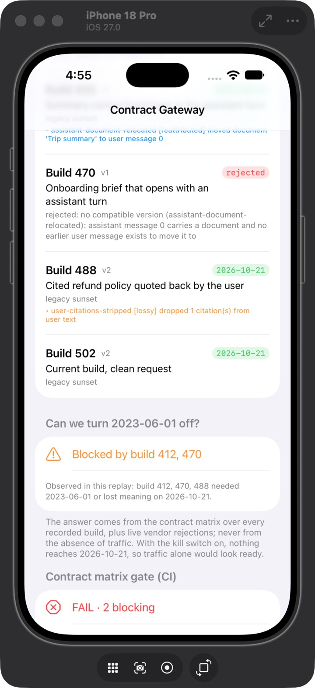
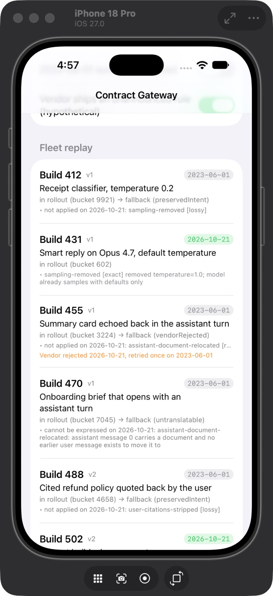

# Contract Gateway — Demo App

**Six App Store builds, two Claude API versions, one gateway deciding where each request goes and what it costs in meaning.**

This is the companion iOS app for [**ai-contract-gateway-kit**](https://github.com/rajatslakhina/ai-contract-gateway-kit). It replays one recorded request from each build of a fictional app that is still in the field through `ContractGateway`, and shows you, per build:

- which provider API version the request went to (`2026-10-21` or `2023-06-01`) and **why** (rollout bucket, kill switch, sunset, fallback);
- every rewrite the gateway made, graded **exact**, **reattributed** or **lossy**;
- whether the vendor rejected it anyway and the gateway retried once on legacy;
- why a request fell back: the rewrites `2026-10-21` would have needed are listed as "not applied", or the reason it can't be expressed there at all;
- whether `2023-06-01` can be switched off yet, and which builds are in the way;
- what the CI contract-matrix gate would say about the release.

## Why this matters

Claude API `2026-10-21` turned three long-accepted request shapes into HTTP 400s: sampling parameters, documents in assistant turns and citations on user text. A backend redeploys and moves on. An iOS app has months of builds in the field that it can't recall. Rewriting requests is the easy part. The hard part is the set of decisions a lead owns: which builds lose meaning, which can't be expressed on the new version at all, what a kill switch actually guarantees, and when it's safe to sunset the old version. This app puts each of those decisions on screen.

## Screenshots

Captured from the app running on an **iPhone 18 Pro simulator (iOS 27.0)**, launched from Xcode on 26 Oct 2026, with the package resolved from GitHub at `1.0.0`. These are captures of the simulator window, not mockups.

| 1 · Default policy and the first builds | 2 · Default: sunset readiness and the CI gate |
|---|---|
|  |  |
| Default settings. The header reads *revision 3* because the sunset toggle had been switched on and off again; the routing is identical to first launch. Build 412 falls back to `2023-06-01` (preserve intent) and lists the lossy rewrite it avoided. Build 431 goes to `2026-10-21` with an *exact* rewrite. | *Blocked by build 412, 470*. **FAIL · 1 blocking**: build 412's lost temperature isn't acknowledged. The rewrites for 455 and 488 are acknowledged, so they pass. |
| **3 · Sunset passed** | **4 · Hypothetical vendor rule** |
|  |  |
| Everything goes to `2026-10-21`. Build 470 is **rejected**: there's no compatible version, and the reason is shown. The gate adds a second blocking line. | Build 455's relocated request hits the made-up rule. The gateway retries **once** on `2023-06-01` (`vendorRejected`), and 455 joins the sunset blockers. |

## What you'll see (default state)

Rollout is at 100%, lossy requests are kept on legacy (`preserve intent`), and `2023-06-01` is still served. On the simulator every row below matched what's listed (screenshots 1 and 2 show most of them). The library's `DemoClaimsTests` also assert the routing, fallbacks, fidelity grades, buckets, blockers and gate counts:

| Build | Recorded request | Goes to | Why |
|---|---|---|---|
| 412 | receipt classifier, `temperature 0.2` on Sonnet 4.6 | `2023-06-01` | removing the temperature would be **lossy**, so it stays on legacy |
| 431 | smart reply on Opus 4.7, `temperature 1.0` | `2026-10-21` | sampling removed, **exact** (model samples with defaults only) |
| 455 | summary document echoed in an assistant turn | `2026-10-21` | document moved to the preceding user turn, **reattributed** |
| 470 | conversation that opens with an assistant turn carrying a document | `2023-06-01` | **untranslatable**: there's no earlier user turn to move the document to |
| 488 | user quotes a cited refund policy | `2023-06-01` | stripping the citations would be **lossy** |
| 502 | current build, clean request | `2026-10-21` | nothing to rewrite |

- **Can we turn 2023-06-01 off?** Blocked by builds **412** and **470**. 455's and 488's rewrites were signed off in `ShippedFleet.acknowledged`, so they don't block.
- **Contract matrix gate:** **FAIL, 1 blocking**: build 412's lost temperature isn't acknowledged. That's the decision a reviewer would be asked to make.

Things to try:

- **Lossy requests → prefer 2026-10-21**: 412 and 488 move to the new version and show their loss.
- **2023-06-01 sunset has passed**: everything goes to `2026-10-21`; build 470 is **rejected** with "no compatible version" and is never sent; the gate adds a second blocking line.
- **Kill switch**: every request goes to `2023-06-01`. The sunset answer stays "blocked", because it comes from the contract matrix rather than from traffic. Traffic that never reaches the new version can't tell you it's safe.
- **Rollout 50%**: the sticky FNV-1a buckets decide; 412 (bucket 9921) and 470 (bucket 7045) stay on legacy without even being tried.
- **Vendor ships an unannounced rule (hypothetical)**: a made-up rule, *not* part of the real `2026-10-21` change, that rejects a user turn ending in a document. Build 455's relocated request hits it; the gateway retries **once** on `2023-06-01`, records `vendorRejected`, and 455 joins the sunset blockers (live evidence the matrix can't have).

Screenshots 3 and 4 show two of these on the simulator; `DemoClaimsTests` covers all five.

Every toggle becomes a new policy revision (shown in the section header) and the whole fleet is replayed through a fresh gateway. A replay that finishes after a newer one has started is discarded, so the header and the rows always describe the same revision. (That guard is compiled in CI but isn't covered by a test.)

## How to run it

1. `git clone https://github.com/rajatslakhina/ai-contract-gateway-demo-app.git`
2. Open `Demo.xcodeproj` in Xcode 16 or later.
3. Xcode resolves **ai-contract-gateway-kit** `1.0.0` from GitHub. The requirement is "up to next major" from `1.0.0`, and the exact revision is pinned in the committed `Package.resolved`.
4. Select the **Demo** scheme and any iOS 17+ Simulator, then Build & Run.

## How it's put together

- `Demo/DemoApp.swift` owns the app-specific data: `ShippedFleet.fixtures` (the six recorded requests) and `ShippedFleet.acknowledged` (the rewrites the team signed off). That's your release history, not the library's.
- The screen is `GatewayDashboardView` from the library's `ContractGatewayUI` module. Its toggles are the core module's `GatewayKnobs`, which map onto a `RoutingPolicy`. It drives `FleetRun`, which builds a fresh `ContractGateway` per policy revision and runs `ContractMatrix` + `MatrixGate`.
- The provider is `SimulatedProvider`, which enforces the library's `ProviderContract`. **No request leaves the device and no API key is involved.**

### Design decisions

- **The library dependency is a remote, version-based Swift package** (`XCRemoteSwiftPackageReference`, `upToNextMajorVersion` from `1.0.0`). The resolved revision (the `v1.0.0` tag) is committed in `Package.resolved`, and CI enforces it with `-onlyUsePackageVersionsFromResolvedFile`. It's never a local path, and never `branch = main`, so every clone builds against the reviewed, released code.
- **Fixtures live in the app, not the library.** The library ships the mechanism; the team ships the data. *Rejected:* a sample fleet bundled in the library. It would blur whose release history is being judged.
- **The sunset answer is traffic-independent.** The ledger's "observed" view is shown too, but as a secondary line. With the kill switch on it shows nothing, and that is exactly why it can't be the primary answer.

## Verification

What has actually happened, stated separately:

- **Library, built and tested locally:** Swift 6.0.3 on Linux (x86_64). Clean build (`rm -rf .build`) with `-warnings-as-errors`, 0 warnings. `swift test`: **69 tests, 0 failures**, including `DemoClaimsTests`, which asserts the outcomes listed in "What you'll see" above.
- **Library CI:** green on `v1.0.0`. It runs on Linux, and on macOS 15 with an iOS Simulator build of `ContractGatewayUI`, all with warnings as errors.
- **This app's CI ([Actions](https://github.com/rajatslakhina/ai-contract-gateway-demo-app/actions)): green.**
  - It runs on macOS 15 (Xcode 16.4).
  - It resolves `ai-contract-gateway-kit` from GitHub exactly at the `Package.resolved` revision (`1.0.0`).
  - It builds the `Demo` scheme for `generic/platform=iOS Simulator`, with warnings as errors set on the `Demo` target.
  - The first run failed on a CI configuration mistake: a command-line `SWIFT_TREAT_WARNINGS_AS_ERRORS=YES` also reached the remote package target, which Xcode compiles with `-suppress-warnings`, and the two flags conflict. The fix moved the setting onto the `Demo` target. The failed run was removed after the fix went green.
- **Run on a simulator: yes.**
  - On 26 Oct 2026, `Demo.xcodeproj` was opened in Xcode on the maintainer's Mac, and Xcode resolved `ContractGateway 1.0.0` from GitHub.
  - The app was built and run on an **iPhone 18 Pro simulator (iOS 27.0)**. The dashboard rendered in the default state shown above.
  - Toggling *sunset has passed* rejected build 470 and added the second gate line.
  - Toggling the *hypothetical vendor rule* made build 455 retry once on `2023-06-01`, and it joined the sunset blockers.
  - The four screenshots above are captures of the simulator window from that run.
  - Not exercised on the simulator, but covered by `DemoClaimsTests`: the kill switch, *prefer 2026-10-21*, and the 50% rollout.
- The project file was checked structurally: braces and parens balance, no dangling object IDs, and the shared scheme points at the app target.
- **Independent review:** 3 rounds by a separate model instance before publication. The round-3 fixes were not re-reviewed.
